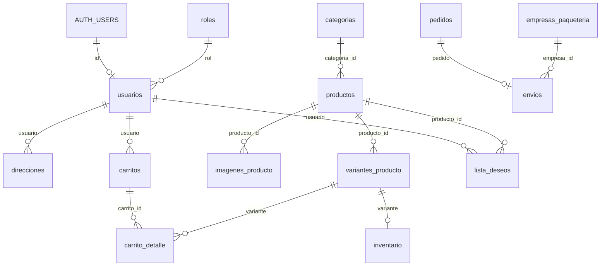
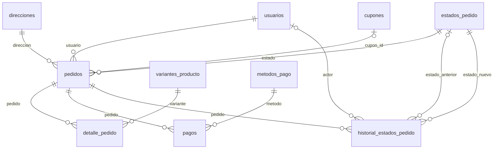
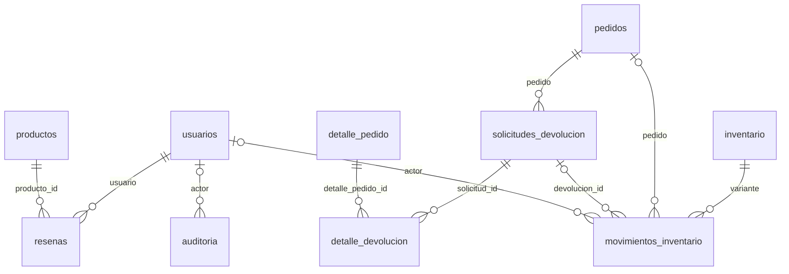

# Modelo entidad–relación

Las relaciones compuestas se anotan en el diccionario. Las tres vistas del modelo comparten las mismas entidades.

## Clientes y catálogo

## Compra y seguimiento

## Inventario y posventa

El catálogo, las variantes, el inventario y los estados mantienen entidades separadas. Los snapshots de dirección, contacto y partidas conservan la información comercial histórica aunque cambie el catálogo. La FK compuesta de pedidos asegura que dirección y propietario coincidan.
