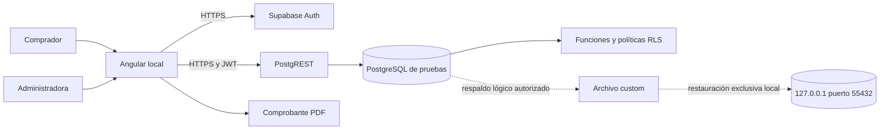

# Ficha técnica y arquitectura

| Campo | Valor |
|---|---|
| Nombre y propósito | Zeli Creativa, tienda académica de demostración para compradores y administración |
| Responsable | Autora del proyecto individual |
| Versión | `0.0.0` según package.json |
| Frontend | Angular 22, TypeScript 6, RxJS, Bootstrap 5, Bootstrap Icons y pdf-lib |
| Backend | Supabase Auth y PostgREST; reglas transaccionales en SQL y PL/pgSQL |
| Datos | PostgreSQL 17.12 informado para el origen y verificado para las herramientas locales; 25 tablas declaradas en `public` |
| Entorno | Windows 11 de 64 bits informado por la autora; Node.js 26.13.1 y npm 11.20.0 comprobados en esta revisión |
| Puertos | Angular local 4200; PostgreSQL de recuperación 55432 sobre loopback |
| URL de demostración | `http://localhost:4200` con `checkout-test` |
| Servicios | Supabase de pruebas; PDF generado en el navegador; pagos y operación logística de demostración |
| Licencias y publicación | Dependencias identificadas en package-lock.json. El paquete se declara privado. La licencia del código propio, el inventario de licencias de recursos y la referencia de entrega del repositorio requieren confirmación de la autora. |

## Contexto, componentes y despliegue

## Flujo y decisiones

- **Compra.** Angular recopila partidas, dirección y teléfono. PostgreSQL calcula la cotización y confirma en una transacción que valida stock, registra el pedido y el pago simulado, actualiza saldo y registra el movimiento.
- **Seguridad.** Supabase Auth gestiona las sesiones. Angular verifica la sesión y el rol para navegar. PostgreSQL aplica privilegios, RLS, comprobaciones de propietario y validación de rol dentro de las operaciones sensibles.
- **Historia.** Se conservan precios, contacto y dirección al comprar. El PDF consulta datos del pedido persistido. El carrito local es estado temporal de interfaz.
- **Recuperación.** El clúster local reproduce las relaciones de aplicación con referencias de Auth auxiliares. El ejercicio cubre datos de aplicación y permite verificar un folio, sin replicar los servicios administrados.
